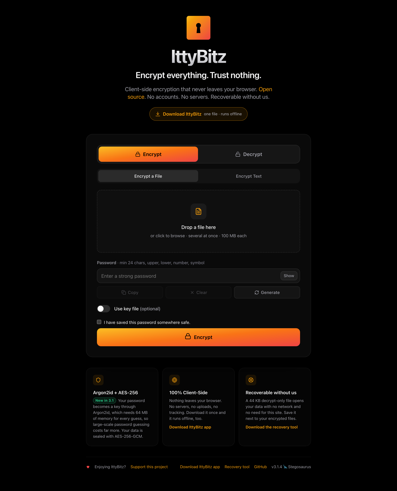

# 🔒 IttyBitz

<br/>

**Tired of worrying where your private files and notes end up?**

With this client-side encryption tool, you can lock down your sensitive information right in your browser—nothing ever leaves your device. 
Whether you’re protecting confidential work documents before sharing them, or storing personal notes you don’t want synced to the cloud, this tool makes security effortless.

IttyBitz offers a secure and private way to encrypt sensitive information directly in your browser without ever sending it to a server.

<p align=center>

</p>

<br/>

> ### 🪶 Locked out? Start here.
>
> **[⬇️ Get the Recovery tool →](Recover/)**
>
> One 44 KB HTML file that decrypts your IttyBitz data with **no installation, no network and no dependencies**, without needing this website at all. It opens files from every version of IttyBitz. Save it next to your encrypted files.

<br/>

## ⚙️ Core features

Here’s what you can do with IttyBitz:
- **Client-side encryption/decryption**: all cryptographic operations happen in your browser. Your files and secrets are never sent to a server.
- **Password & key file protection**: secure your data with a strong password, an optional key file, or both for an added layer of security. You can use any existing file or generate a new, cryptographically secure key file directly within the app.
- **File & text support**: encrypt and decrypt both files and text snippets. Drop several files at once: each is encrypted (or decrypted) on its own, with its own salt and key derivation, and downloaded under its own name; a file that fails is named in the summary and does not stop the others. A key file shows a short fingerprint (the first 8 hex characters of its SHA-256) next to its name, and a generated key file carries the same fingerprint in its name (`ittybitz-key-[0e64cc39].bin`), so the right file can be recognised months later without revealing anything about it.
- **QR code sharing**: easily share encrypted text snippets via a downloadable QR code — or **print a one-page emergency card**: the QR, the encrypted text in full, and three steps to decrypt it: open ittybitz.app (or the Recovery tool if the website is not available), enter the encrypted text by pasting, scanning or typing it, and enter the password. The card states whether a key file is needed and, if so, identifies it by fingerprint rather than by name. The password is never on the card, and the QR code and encrypted text reveal nothing about the secret without it. Only encrypted text can be printed this way; decrypted text and seed phrases never reach paper from this page.
- **Hardware-wallet SeedQR export**: when decrypted text is a valid BIP-39 seed phrase, IttyBitz auto-detects it and can display a **Standard SeedQR** for direct import into hardware wallets (Coldcard, SeedSigner, Sparrow, Specter, Krux, Keystone, Jade). Any other decrypted text can be shown as a plain QR. Both are blurred until you deliberately reveal them.
- **One self-contained file**: the entire app is a single HTML file — no dependencies, no build, no service worker. Save it (or *File → Save Page As…* from [ittybitz.app](https://ittybitz.app)) and it runs offline, on an air-gapped machine, from a USB stick, in twenty years.
- **Privacy-focused UI**: the secret text field is blurred from the first character you type or paste, to prevent shoulder-surfing; the eye button reveals it. Decrypted output is blurred until you choose to reveal it, and nothing secret appears on a printout.
- **Clipboard auto-clear**: copied passwords and output are wiped from the clipboard after 60 seconds. The clipboard is never read: if you leave the page or copy something else in the meantime, it is left alone.
- **Backward-compatible file format**: encrypted payloads include an `IBTZ` version header so the app can evolve without breaking old files. Since 3.1.0 new files use format v2 (Argon2id); anything encrypted with prior versions still decrypts identically.
- **No accounts required**: works entirely without user accounts or sign-ins.

<br/>

## 🥤 How to Use IttyBitz

At the top, you’ll find two simple tabs:  **Encrypt**  and **Decrypt**.

- In **Encrypt** mode, you can lock away a file or a text snippet with a password, a key file, or both.

| Encrypting a file | Encrypting text |
|---	|---	|
|	1.	Select the Encrypt tab.|	1.	Select the Encrypt tab.|   	
|	2.	Ensure the File option is selected.	|	2.	Choose the Text option.|
|	3.	Select or drop the file(s) you wish to encrypt. Nothing is uploaded; the files stay on your device.|	3.	Enter your text in the provided box.|
|	4.	Enter a strong password. For extra security, toggle "Use Key File" to either select an existing file or generate and download a new one. |	4.	Enter a password. For extra security, toggle "Use Key File" to add a key file.|
|	5.	Tick "I have saved this password somewhere safe", then click Encrypt and download the encrypted file for safekeeping.|	5.	Tick "I have saved this password somewhere safe" and click Encrypt. You can then copy the text, or click the **QR code icon** to view and download the encrypted output as a PNG file for easy, secure sharing.|

- In **Decrypt** mode, you simply unlock your protected content and get it back instantly—only if you hold the right key.

| Decrypting a file | Decrypting a text |
|---	|---	|
|	1.	Select the Decrypt tab.|	1.	Select the Decrypt tab.|   	
|	2.	Ensure the File option is selected.|	2.	Choose the Text option.|
|	3.	Select or drop the encrypted file(s).|		3.	Paste your encrypted text into the box.|
|	4.	Enter the same password (and the key file, if used) and click Decrypt.|		4.	Enter the password (and optional key file).|
|	5.	Download the decrypted file.|	5.	Copy the decrypted text output.|

<br/>

## 🛡️Security features

The security of your data is the highest priority. Here is a summary of the security measures built into IttyBitz:

- **Client-Side operations:** all encryption and decryption processes happen entirely within your browser. Your password, key files, and secret data are **never** transmitted over the internet or stored on any server.

- **Strong encryption standard:** IttyBitz uses **AES-256-GCM**, a modern authenticated encryption cipher that provides both confidentiality and data integrity.
- **Memory-hard key derivation:** your password is not used directly as the encryption key. Since 3.1.0 it is run through **Argon2id** (RFC 9106, winner of the Password Hashing Competition) with **64 MiB of memory and 3 passes**, so every guess an attacker makes costs 64 MiB of memory as well as time, which blunts the GPU and custom-hardware attacks that make simpler functions cheap to brute-force. A key file, if used, enters Argon2id as a secret input (its SHA-256). Files made before 3.1.0 used **PBKDF2** with **1,000,000 iterations**, and still decrypt exactly as before. Argon2id runs as a small WebAssembly module built from readable source in this repository; it needs a browser from 2022 or later (Chrome 97, Firefox 102, Safari 16).
- **Cryptographically secure randomness:** the application uses `window.crypto.getRandomValues()` to generate the salt for key derivation, the Initialization Vector (IV) for AES-GCM, the random characters for the password generator, and the data for the key file generator. This is a cryptographically secure pseudo-random number generator (CSPRNG) that is suitable for security-sensitive applications.
- **Enforced password strength:** IttyBitz refuses to encrypt unless the password is at least 24 characters long and mixes uppercase, lowercase, numbers and symbols. The password field turns green as soon as it qualifies. Because the password is cleared from the page the moment you encrypt, you must first tick **I have saved this password somewhere safe**; the box unticks itself whenever the password changes.
- **Best-effort memory clearing:** once a result has been handed over, the application overwrites the decrypted data, the key file's bytes and the 64 MiB of Argon2id working memory. The derived encryption key is created as non-extractable, so the browser never exposes it to the page at all. Note: JavaScript's garbage collector may retain copies of data elsewhere in the heap, so this is a best-effort mitigation rather than a guarantee.
- **No user tracking:** the application does not use cookies, analytics, or trackers. Your activity is your own.

<br/>

## 🔬 Third-party validation

### **Independent security review**
This application has undergone a detailed security analysis. You can view the full report here: [Security analysis report](https://claude.ai/public/artifacts/f4bb6437-1130-4fd3-bc56-74b2399274f9) 🔗

An in-repo audit of v2.8.1, the last version before the v3.0.0 single-file rewrite, is in [SECURITY-AUDIT.md](SECURITY-AUDIT.md). It has not been re-run against v3.x; an addendum at the top maps its findings onto the current architecture.

### **Open source advantage**
- **Transparent code**: every line of security code is publicly auditable
- **Community verified**: security experts worldwide can review our implementation
- **No hidden backdoors**: impossible to hide security vulnerabilities

### **Industry-standard algorithms**
- **Standard algorithms**: AES-256-GCM for encryption, and Argon2id (RFC 9106) for key derivation. Files from before 3.1.0 use PBKDF2-HMAC-SHA-256, which IttyBitz still reads. AES-256-GCM is FIPS-approved; Argon2id is an IETF standard but not a FIPS algorithm (this app has not undergone formal FIPS certification either way)
- **Memory-hard key derivation**: Argon2id with 64 MiB of memory per guess, to resist brute-force attacks on GPUs and custom hardware
- **Privacy-focused design**: no accounts, no servers, no tracking — all operations stay in your browser

<br/>

## 🪶 Recovery tool — decrypt without IttyBitz

**[⬇️ Download it](https://github.com/seQRets/ittybitz/releases/download/v3.1.2/ittybitz-recovery.html)** (44 KB, one file) · [open it in your browser](https://ittybitz.app/ittybitz-recovery.html) · [how to save and use it](Recover/)

A standalone page that decrypts your IttyBitz files with **no dependencies, no network, no installation and no build step**. Save it alongside your encrypted data — on the same USB stick, the same backup drive, the same safe.

It exists so that recovering your own data never depends on this website, on GitHub Pages, or on this project being maintained. Open it in any browser, on an air-gapped machine, in twenty years.

> **Saved a copy before 3.1?** Replace it. Files encrypted with IttyBitz 3.1 or later use Argon2id, which only the 3.1 Recovery tool and newer can open. The new tool still opens everything older, too.

It is decrypt-only, its `Content-Security-Policy` blocks all network access outright, and CI replays real ciphertexts from every format, v1.0 onward, through the exact published file on every change — so it cannot silently drift from the main implementation.

**[`Recover/`](Recover/) covers the rest**: how to save it to your own disk, how to verify its checksum, why it can be trusted, and where the file lives in this repository.

<br/>

## 📋 Release history

Every version, with what changed in each, is listed in the [**changelog**](CHANGELOG.md). Full notes per release live in [`docs/releases/`](docs/releases/).

Nothing has ever stopped decrypting: anything encrypted with any version of IttyBitz still decrypts today, and that guarantee is enforced automatically in CI against real ciphertexts from every prior release. The cipher has always been AES-256-GCM. Since 3.1.0, new files derive their key with Argon2id instead of PBKDF2 (container format v2); files made earlier keep opening exactly as before.

<br/>

## 📜 Licensing

IttyBitz is free software released under the [**GNU General Public License v3.0**](LICENSE).

You are free to use, modify, and distribute this software. Any derivative works must also be released under the GPLv3.

<br/>

## 💻 Run it locally / offline

IttyBitz is **one HTML file**. There is nothing to install, compile, or configure — not for you, not for anyone you share it with.

**Three ways to get a local copy:**

1. **Download it** from the [latest release](https://github.com/seQRets/ittybitz/releases/latest) — grab `ittybitz.html`, then double-click it. Done.
2. **Save the page**: open [ittybitz.app](https://ittybitz.app), then *File → Save Page As…* (⌘S / Ctrl+S). If your browser asks, choose **"Web Page, HTML Only"** — it is a single file, so "Complete" only adds a folder you don't need.
3. **Clone the repo** and open `site/index.html`, or serve it with [Node.js](https://nodejs.org):

```bash
git clone https://github.com/seQRets/ittybitz.git
cd ittybitz
npm run dev   # serves site/ at http://localhost:9002
```

Once you have the file it works with the network disconnected — Web Crypto runs in your browser, and nothing is fetched, uploaded, or logged. A `Content-Security-Policy` in the file enforces that: it cannot make a network request even if it tried.

### 🔎 Verify your download

Recommended for a security tool. Every [release](https://github.com/seQRets/ittybitz/releases/latest) ships a **`SHA256SUMS.txt`** alongside `ittybitz.html` and `ittybitz-recovery.html`. Put the file(s) you downloaded in the same folder as `SHA256SUMS.txt`, then:

**macOS / Linux**

```bash
shasum -a 256 -c SHA256SUMS.txt      # or: sha256sum -c SHA256SUMS.txt
```

Expect `ittybitz.html: OK` (and `ittybitz-recovery.html: OK`).

**Windows (PowerShell)**

```powershell
certutil -hashfile ittybitz.html SHA256
```

…then compare the printed hash against the matching line in `SHA256SUMS.txt`.

The file is byte-identical wherever you got it — the website, the release asset, or this repository's `site/index.html` / `site/ittybitz-recovery.html`.

### 🧰 Build it yourself

You never need to do this to *use* IttyBitz. It is for anyone who wants to check, on their own computer, that the published files really are made from the code in this repository. It takes about five minutes.

**Step 1 — Install Node.js.** Go to [nodejs.org](https://nodejs.org), download the version marked **LTS**, and install it like any other program. That is the only thing you need to install.

**Step 2 — Download the source code.** Open the [latest release](https://github.com/seQRets/ittybitz/releases/latest), scroll down to **Assets**, and click **Source code (zip)**. Double-click the downloaded file to unzip it. You now have a folder with a name like `ittybitz-3.1.2`.

**Step 3 — Open a terminal in that folder.**
- **Mac:** open **Terminal** (in Applications → Utilities). Type `cd` and a space, drag the folder onto the Terminal window, and press Return.
- **Windows:** open the folder, click the address bar at the top of the window, type `cmd`, and press Enter.

**Step 4 — Build.** Type this and press Return (Enter on Windows):

```bash
npm run build
```

After a second or two, the last line should say:

```
Done. The files you built are identical, byte for byte, to the published ones listed in SHA256SUMS.txt.
```

That is the proof: the app and the Recovery tool you just built from the source are exactly the files published with that release.

**Optional — run the security tests.** Type `npm run test:crypto` and press Return. After about 15 seconds it should end with `All crypto regression checks passed.`

**Optional — try your build.** Type `npm run dev`, then open [http://localhost:9002](http://localhost:9002) in your browser. Press Ctrl+C in the terminal when you are done.

If you use Git, `git clone https://github.com/seQRets/ittybitz.git` and `cd ittybitz` replace steps 2 and 3.

#### For contributors

**What `npm run build` does.** It assembles `site/index.html` from the parts in [`scripts/build/`](scripts/build/): the page and its styles (`head.html`), the vendored [`qrcode-generator`](https://github.com/kazuhikoarase/qrcode-generator) (MIT), the Argon2id core (`argon2-core.template.js` plus a 1.4 KB WebAssembly module that [`scripts/wat.mjs`](scripts/wat.mjs), a dependency-free assembler, builds from the readable [`argon2.wat`](scripts/build/argon2.wat)), the crypto core (`crypto-core.js`), the BIP-39 core (with the wordlist copied from [`src/lib/bip39.ts`](src/lib/bip39.ts)), the seed-fingerprint code (`fingerprint-core.js`, vendored from myseedphrase.app), and the interface (`app.js`). It writes the same Argon2id block into the Recovery tool, then pins every inline script's hash in both files' `Content-Security-Policy` and regenerates `SHA256SUMS.txt`.

**What `npm run test:crypto` proves.** The app and the Recovery tool decrypt real ciphertexts from every release and every format. For the older formats (v0 and v1), ciphertexts made by the frozen reference [`src/lib/crypto.ts`](src/lib/crypto.ts) open in the app; the app no longer writes those formats. For the current format (v2), Argon2id matches the RFC 9106 test vector and Node's built-in Argon2id, and whole files open in both directions between the app, the Recovery tool and an independent implementation built only from Node's own crypto, with and without key files.

**When to rebuild.** After changing anything in `scripts/build/`, `scripts/wat.mjs` or `src/lib/bip39.ts`, run `npm run build` before committing. After editing `site/ittybitz-recovery.html` by hand, `npm run update-csp-hashes` is enough, except for its `ittybitz-argon2` block, which the build generates: change `scripts/build/argon2*` and run `npm run build` instead. Skipping this leaves a stale hash in a page's security policy, and the browser then refuses to run the edited script. CI rebuilds everything from source on every push and fails if the committed files differ.

**Requirements.** Node.js 24.7 or newer and nothing else: no `npm install`, no dependencies. The tests need 24.7 for Node's built-in Argon2id, and `npm run test:crypto` says so plainly on an older Node.

**What is where.**

| Path | What it is |
|---|---|
| [`site/`](site/) | The published website: `index.html` (the app), `ittybitz-recovery.html`, `sw.js` (retires the old installed app), icons, `CNAME` |
| [`scripts/build/`](scripts/build/) | The parts `site/index.html` is assembled from |
| [`scripts/`](scripts/) | The build (`build-app.mjs`, `update-csp-hashes.mjs`, `wat.mjs`), the test suite (`crypto-regression.mts`, `crypto-fixtures.json`), the dev server (`serve.mjs`) and the Node version check (`check-node.mjs`) |
| [`src/lib/`](src/lib/) | Frozen reference implementations the tests compare against ([why](src/lib/README.md)) |
| [`Recover/`](Recover/) | Where to find, save and verify the Recovery tool |
| [`docs/`](docs/) | Release notes for every version, and the image above |
| [`.github/`](.github/) | CI (crypto tests and the reproducibility check), the GitHub Pages deploy, Dependabot |

## ❤️ Support this project

If you find IttyBitz useful, please consider supporting its development. Your donation helps keep the project alive and ad-free.

**Donate:** [https://coinos.io/seQRets/receive](https://coinos.io/seQRets/receive)
